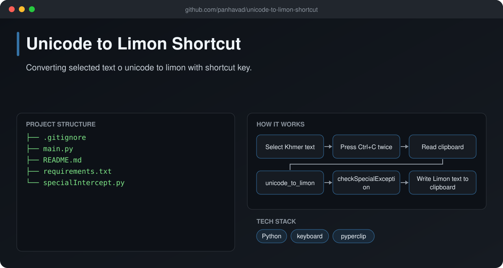

# Unicode to Limon Shortcut

  [](https://github.com/panhavad/unicode-to-limon-shortcut/releases/latest)

Convert **Khmer Unicode text to Limon font encoding** with a keyboard shortcut. Select text, press **Ctrl+C twice**, and the clipboard is converted to Limon - no website or copy-paste between apps.



## Features

- Global hotkey: double Ctrl+C
- Khmer Unicode -> Limon conversion
- Special-case fixes for known glyph issues
- Runs in the background, Esc to exit

## How it works


## Getting started

```bash
pip install -r requirements.txt
python main.py
```

## Download

Grab the packaged source from the [latest release](https://github.com/panhavad/unicode-to-limon-shortcut/releases/latest).

## Tech stack

- Python
- keyboard
- pyperclip

## Project structure

```text
unicode-to-limon-shortcut/
├── docs/
├── .gitignore
├── main.py
├── README.md
├── requirements.txt
└── specialIntercept.py
```

## Original notes

# Unicode to Limon Shortcut
## What is it?

Converting selected text from Unicode to Limon with a shortcut key.

## Why this?

With shortcut it is faster to transform from unicode to limon, instead of using the website or copy-paste to other applications.

## How does it work?

1. Install the required dependencies
`pip install -r .\requirements.txt`
2. Execute the main.py file
`py main.py`
3. CRLT+C twice to transform text automatically
4. The transformed text will quietly be put back on your clipboard and ready to paste
